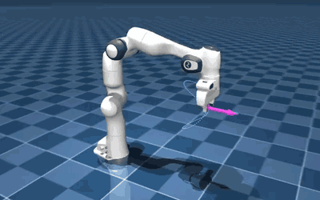
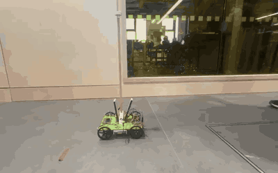
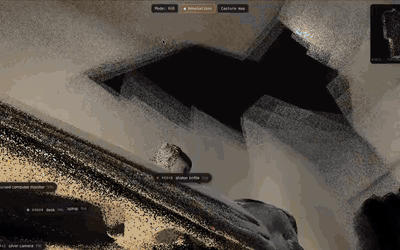
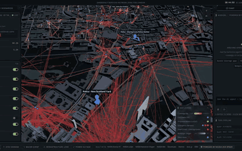
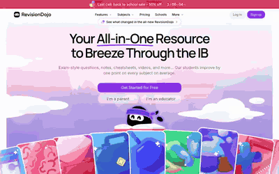
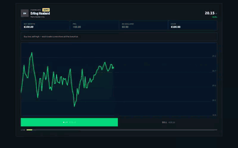

<h1 align="center">Harrish Ayyanar</h1>

  Robotics & AI @ UCL · Research @ <a href="https://www.hybird.ai">HyBird</a> · prev. <a href="https://github.com/Harrishayy/Cereberus">Cisco</a>, <a href="https://generallearning.com">General Learning (YC F24)</a> 
  Robots, world models and perception. Currently building <a href="https://theultras.app">Ultras</a>.

  <a href="https://harrishayyanar.com"><picture><source media="(prefers-color-scheme: dark)" srcset="assets/btn/portfolio-dark.svg" /></picture></a>
  <a href="https://scholar.google.com/citations?user=_2UtegcAAAAJ&hl=en"><picture><source media="(prefers-color-scheme: dark)" srcset="assets/btn/scholar-dark.svg" /></picture></a>
  <a href="https://www.linkedin.com/in/harrish-ayyanar/"><picture><source media="(prefers-color-scheme: dark)" srcset="assets/btn/linkedin-dark.svg" /></picture></a>
  <a href="https://x.com/harrishayy"><picture><source media="(prefers-color-scheme: dark)" srcset="assets/btn/x-dark.svg" /></picture></a>

<a href="https://harrishayyanar.com"><b>harrishayyanar.com</b></a>

### Selected work

<table>
  <tr>
    <td width="50%" valign="top">
      
      
🎯 <b>Kinesis</b> · residual RL for 6-DoF tracking 
      <picture><source media="(prefers-color-scheme: dark)" srcset="assets/label/robotics-dark.svg" /></picture> 
      Trained a PPO policy that corrects a damped-least-squares IK controller, so a Franka Panda tracks targets to <b>0.46 mm RMS</b> under sensor noise and control delay.

      <code>Python</code> <code>MuJoCo</code> <code>PyTorch</code>
    </td>
    <td width="50%" valign="top">
      
      
⚖️ <b>Cart-pole</b> · underactuated control 
      <picture><source media="(prefers-color-scheme: dark)" srcset="assets/label/robotics-dark.svg" /></picture> <picture><source media="(prefers-color-scheme: dark)" srcset="assets/label/win-ucl-systems-dark.svg" /></picture> 
      Balanced a pole on a moving cart with embedded compute, benchmarking LQR, cascaded PID and MPC on a 500 Hz state-estimation loop.

      <code>C++</code> <code>Python</code> <code>Arduino</code> <code>Fusion 360</code>
    </td>
  </tr>
  <tr>
    <td width="50%" valign="top">
      
      
🧊 <b>Spatiality</b> · phone video to labelled 3D 
      <picture><source media="(prefers-color-scheme: dark)" srcset="assets/label/perception-dark.svg" /></picture> 
      Built a pipeline that turns a phone video into a 12–50M-point 3D scene with every object segmented and named, in <b>under 20 minutes</b> and with no manual labelling.

      <code>Python</code> <code>PyTorch</code> <code>VGGT</code> <code>SAM 3</code>
    </td>
    <td width="50%" valign="top">
      
      
📡 <b>NeMo-Ray</b> · digital twin of London's emergency network 
      <picture><source media="(prefers-color-scheme: dark)" srcset="assets/label/ai-dark.svg" /></picture> <picture><source media="(prefers-color-scheme: dark)" srcset="assets/label/win-nvidia-dark.svg" /></picture> 
      Ray-traced radio coverage across London; when masts fail, an agent redeploys satellite cells to keep 300,000 responders connected.

      <code>Sionna RT</code> <code>cuOpt</code> <code>Nemotron</code> <code>Next.js</code>
    </td>
  </tr>
  <tr>
    <td width="50%" valign="top">
      
      
🎓 <b>RevisionDojo & OnePrep</b> · General Learning (YC F24) 
      <picture><source media="(prefers-color-scheme: dark)" srcset="assets/label/software-dark.svg" /></picture> 
      Shipped 8+ microservices and two iOS apps, built the Glicko-2 rating model and reinforcement fine-tuned models for edtech used by <b>1.5M students</b>.

      <code>TypeScript</code> <code>Swift</code> <code>Next.js</code> <code>PostgreSQL</code>
    </td>
    <td width="50%" valign="top">
      
      
⚽ <b>Ultras</b> · a football prediction market 
      <picture><source media="(prefers-color-scheme: dark)" srcset="assets/label/software-dark.svg" /></picture> 
      Co-founded a football prediction market for web and iOS where fans trade shares in real players, priced by an XGBoost model tested on <b>29,108 unseen player-seasons</b>.

      <code>TypeScript</code> <code>Next.js</code> <code>React Native</code> <code>XGBoost</code>
    </td>
  </tr>
</table>

### Research

- 📄 **[ASpec](https://openreview.net/pdf?id=UESTP6dR1K)** · ICLR 2026 · Co-authored a method that auto-discovers teams of specialist LLM agents and learns when to rebuild them: +6% accuracy at 47% lower cost.
- 📄 **[PEBBLE](https://openreview.net/pdf?id=ffvNvoJVgE)** · NeurIPS 2025 workshop · Co-authored a benchmark that grades LLM tutors on how they teach, not just their answers.
- 🛡️ **[Cereberus](https://github.com/Harrishayy/Cereberus)** · Cisco · Co-led an open-source runtime that gives each AI agent its own syscall policy, enforced by eBPF hooks in the Linux kernel.

### Wins

- 🏆 **[Casework](https://github.com/Harrishayy/monopoly)** · 1st, Real-World Agents Hackathon · Built an AI inbox that turns tenant calls and emails into cases and holds anything risky for a human.
- 🏆 **[Boxonwils](https://github.com/EdwinIsCoding/Boxonwils)** · 1st, UCL Robotics Challenge · Engineered a robot that maps unknown terrain with SLAM and plans collision-free paths through it.
- 🏆 **[Uncookd](https://github.com/Harrishayy/uncookd)** · 1st, AgentVerse Hackathon · Architected a classroom where three AI agents teach a student's question on a shared whiteboard.
- 🥈 **[Nemotron Reasoning Challenge](https://github.com/MehulChourasia28/NVIDIA-NemotronKaggleChallenge)** · Kaggle silver, top 3% · Fine-tuned a 30B model with LoRA on solver-verified reasoning traces.

### Stack

<table>
  <tr><td width="30%"><b>Languages</b></td><td>Python · C++ · C · TypeScript · Go · Swift · CUDA · SQL · MATLAB</td></tr>
  <tr><td><b>Robotics & ML</b></td><td>PyTorch · ROS 2 · MuJoCo · Isaac Lab · OpenCV · SAM 3 · scikit-learn</td></tr>
  <tr><td><b>Product</b></td><td>Next.js · React Native · FastAPI · PostgreSQL</td></tr>
  <tr><td><b>Infra & hardware</b></td><td>Linux · eBPF · Docker · AWS · GCP · STM32 · Jetson · Arduino · Raspberry Pi</td></tr>
</table>
